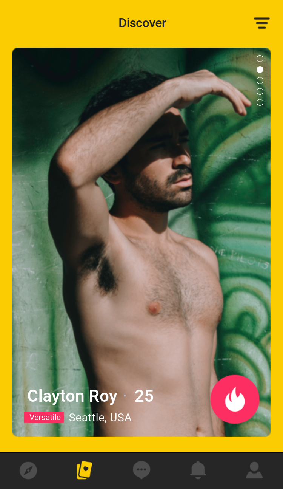
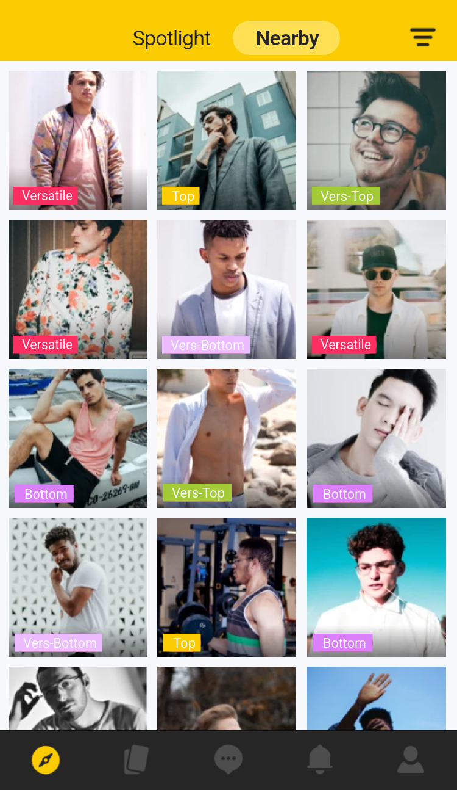
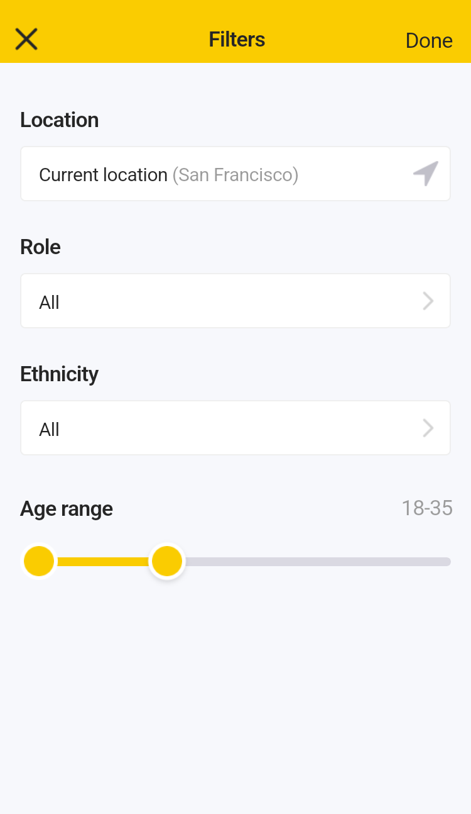
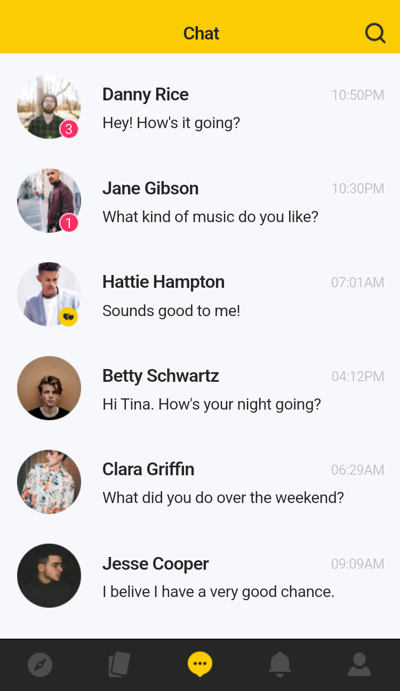
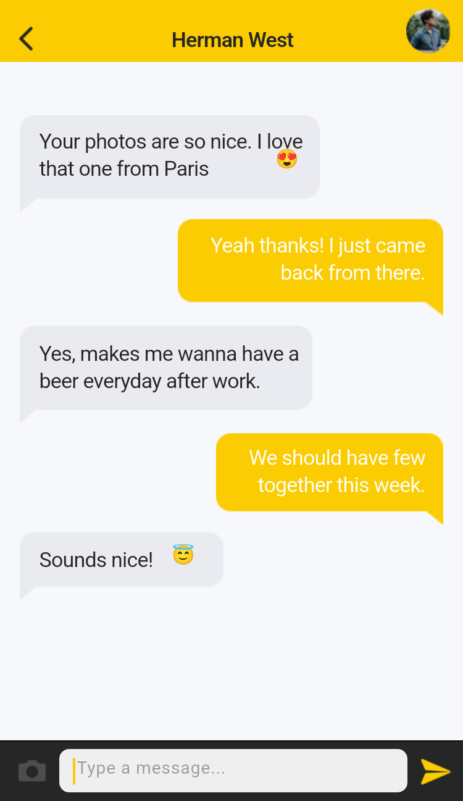
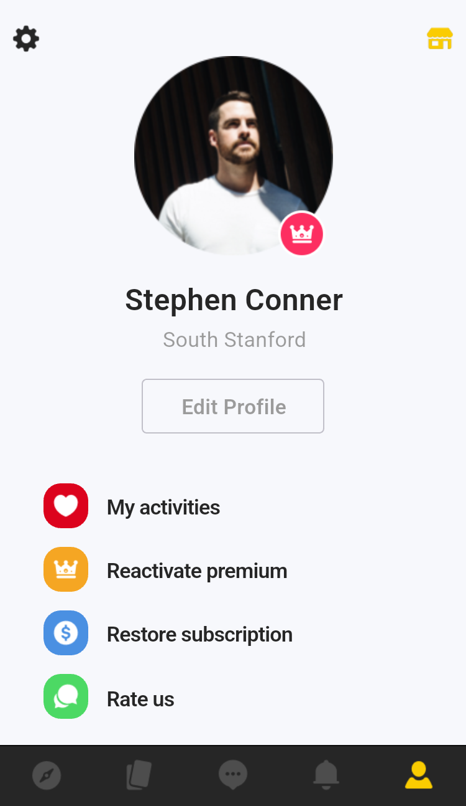

# BearHunt

基于 Pixso 设计稿实现的 Flutter 交友应用演示。覆盖 `Page 1` 的 57 个界面状态，包括登录与资料引导、发现滑卡、附近与 Spotlight、筛选、聊天、通知、资料编辑、积分与 Premium。原稿的 `Symbols` 是组件资源页。

## 界面截图

截图由 Android API 34 模拟器中的 Flutter 界面导出。截图裁去系统状态栏，长页面按完整内容导出。

<table>
  <tr>
    <td align="center"><br>登录</td>
    <td align="center"><br>发现</td>
    <td align="center"><br>附近</td>
    <td align="center"><br>筛选</td>
  </tr>
  <tr>
    <td align="center"><br>聊天列表</td>
    <td align="center"><br>会话详情</td>
    <td align="center"><br>我的资料</td>
    <td align="center"><br>Premium</td>
  </tr>
</table>

[查看 57 个界面的截图与 Pixso 画板对应表](docs/screenshots/README.md)

## 运行

使用 Flutter 3.41.6 和 Dart 3.11.4。启动模拟器后，运行以下命令。若设备 ID 与示例不同，请使用 `flutter devices` 列出的 ID。

```sh
flutter pub get
flutter devices
flutter run -d emulator-5554
```

点击登录页的 **Connect with Facebook** 进入本地资料引导。完成引导后，可通过底栏进入附近、发现、聊天、通知和我的资料。

生成 ARM64 验收用 APK。

```sh
flutter build apk --release --target-platform android-arm64
```

输出文件为 `build/app/outputs/flutter-apk/app-release.apk`，使用本地调试签名。

## 项目结构

```text
lib/
├── main.dart                  # 应用主题、页面路由、安全区和过渡
├── design/
│   ├── scene.dart             # 画板、图层、选项和尺寸的数据模型
│   └── scene_view.dart        # 共享 Flutter 渲染器、滚动区和固定栏
└── features/
    ├── session.dart           # 演示会话、筛选、资料、聊天和购买状态
    ├── commands.dart          # 共用按钮、输入弹窗和底栏交互
    ├── social.dart            # 发现、附近、聊天、通知
    ├── profile.dart           # 引导、资料、选择器、筛选和设置
    └── premium.dart           # 商店、订阅、权益和提示
assets/
├── pixso/scenes.json          # 57 个画板的布局与文字样式
├── pixso/art/                 # 去重后的照片、图标、插画与特效
└── fonts/                     # BearHunt 标识使用的 Montserrat 字体子集及授权
integration_test/
└── pixso_screens_test.dart    # 主流程测试与全量截图导出
test_driver/screenshots.dart   # 将模拟器截图写入项目目录
android/、ios/、web/           # Flutter 平台入口与启动资源
docs/screenshots/              # 应用截图和画板索引
```

`SceneLibrary` 启动时加载本地画板数据。共享的 `SceneView` 把形状、富文本和局部图像渲染成 Flutter 组件，并按屏宽缩放设计坐标。长内容使用滚动区，主导航和聊天输入栏固定在底部。各功能模块把画板上的可操作区域绑定到路由、表单和 `DemoSession`，同一套渲染器处理正常页、空态、权限提示及 Premium 变体。

## 验证与截图导出

```sh
flutter analyze
flutter test integration_test/pixso_screens_test.dart -d emulator-5554
flutter drive --debug -d emulator-5554 \
  --driver=test_driver/screenshots.dart \
  --target=integration_test/pixso_screens_test.dart \
  --dart-define=BEARHUNT_CAPTURE=true
```

截图模式将 `01.png`–`57.png` 写入 `docs/screenshots/`。

## 演示范围

应用使用本地样本资料和内存状态。Facebook 登录、聊天投递、购买、地图和系统权限使用演示交互。重新启动会重置会话。界面保留设计稿的英文文案，状态栏使用运行平台的系统样式。
